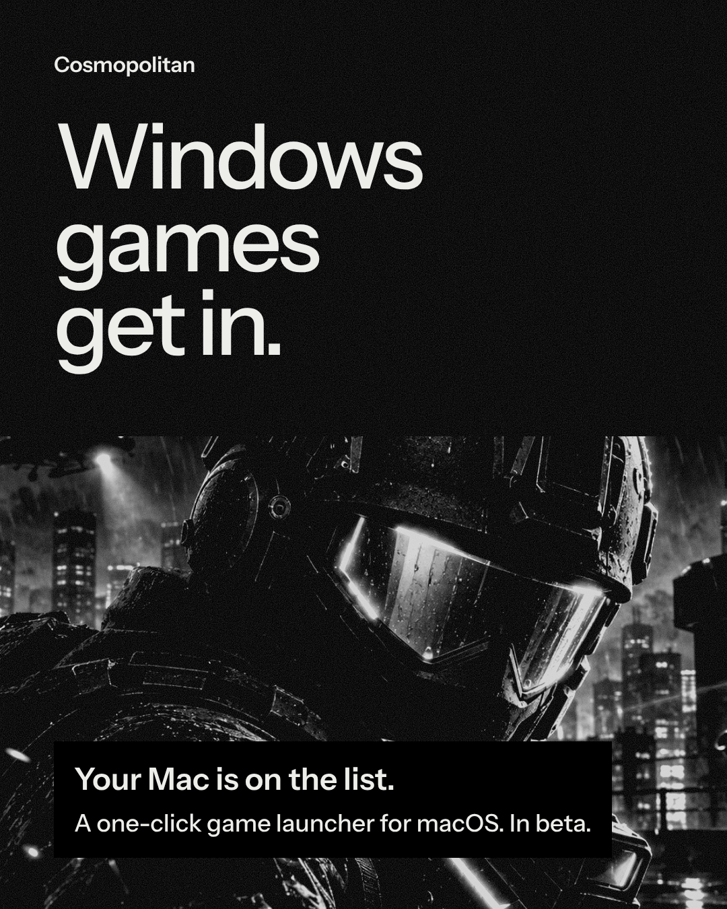
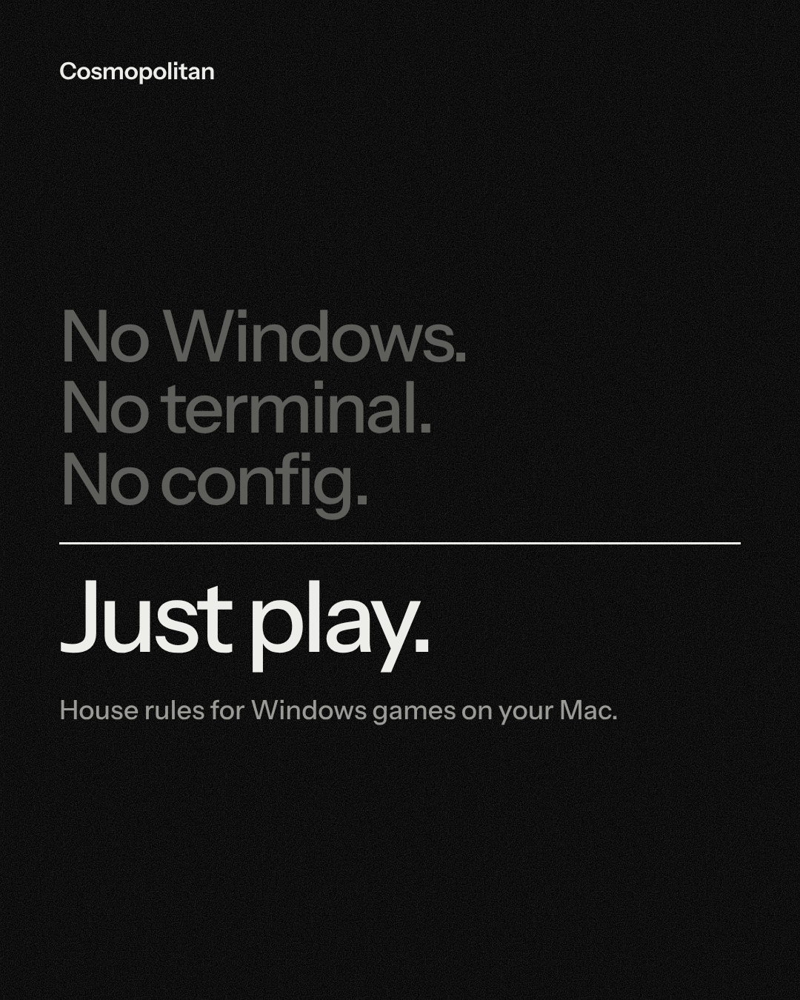
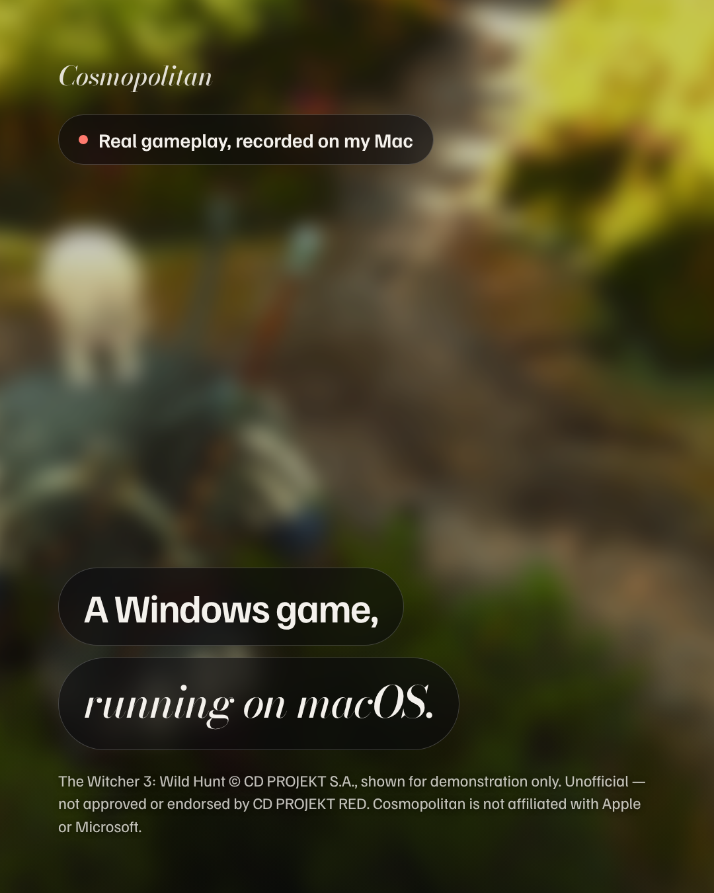

# Cosmopolitan

  
  
  

<b><a href="https://github.com/cyber-prinzesse/Cosmopolitan/releases/latest">⬇ Download Cosmopolitan for Mac</a></b> · free · Apple Silicon

Runs Windows games and programs on Apple Silicon Macs through Wine, with the graphics
layers (DXMT, DXVK, D3DMetal), controllers, runtimes and community fixes handled
automatically. Free, open, unnotarized.

## Install and updates

Download `Cosmopolitan-<version>.dmg` from the [latest release](https://github.com/cyber-prinzesse/Cosmopolitan/releases/latest),
open it and drag the app to Applications. The app is not notarized (no paid Apple Developer
account), so macOS blocks the first open with "Apple could not verify…". Click **Done**, then open
**System Settings → Privacy & Security**, scroll to "Cosmopolitan was blocked", click **Open Anyway**
and confirm. Once is enough. (Right-click → Open no longer bypasses this on macOS 15 and later.)

Updates arrive inside the app (Sparkle). Every GitHub release carries the signed update
feed, so publishing a release with `scripts/release.sh` is what ships an update; the `.zip`
is what the updater downloads, the `.dSYM.zip` holds the debug symbols for crash reports.

## Stores

**Stores…** next to the programs grid. *Install Battle.net* downloads the official installer into the bottle and
runs it (Arial and software rendering are set up first, the known fixes under Wine); its games then appear in the
grid. *Epic Games* goes through [Legendary](https://github.com/derrod/legendary) (installed with pipx on first use):
sign in with the code from Epic's login page, pick a game under *Install Epic game*, and it downloads into
`C:\Games\Epic` and launches with Epic's auth parameters through this bottle's engine and drivers. *GOG* goes through
[lgogdownloader](https://github.com/Sude-/lgogdownloader) (Homebrew): sign in with the address GOG's login page lands
on, pick a game under *Install GOG game*, and the DRM-free Windows build is installed straight into `C:\GOG Games`.
*Install Epic Games Launcher…* puts Epic's own Windows client into the bottle too (silent MSI); Cosmopolitan starts it with
`-SkipBuildPatchPrereq` on the DXMT driver set and finishes its pending self-update before each launch, which is what
otherwise leaves it in a restart loop under Wine. GOG Galaxy's Windows client is not offered: its Qt 6 web view stays
blank under every Direct3D layer available on macOS (other Mac Wine launchers report the same), so the menu opens or
installs GOG's native Mac client instead, and Windows-only GOG builds come through lgogdownloader.

## D3DMetal (Direct3D 12) is optional and comes from Apple

Direct3D 10/11 games run through DXMT out of the box. Direct3D 12 needs Apple's
D3DMetal, which is proprietary and **not included**. Download the Game Porting Toolkit
from https://developer.apple.com/games/game-porting-toolkit/, then in Cosmopolitan:
Drivers › **D3DMetal…** › *Install from Apple's download…*, read Apple's license, and
accept it. You can remove it again from the same place. See `THIRD_PARTY_NOTICES.md`.

## Anti-cheat

Nothing here bypasses or disables anti-cheat, ever. Games are badged honestly:
"Online won't work (Easy Anti-Cheat)" or "Kernel anti-cheat — will not run". For the
latter, the app points to cloud gaming.

## Not built (and why)

- **SteamGridDB art**: needs a personal API key; Steam's own CDN art is used instead.
- **Discord Rich Presence bridge**: not built yet.
- **DualSense adaptive triggers**: not possible under Wine for XInput games; rumble works through SDL, and games with native DualSense support can get the real pad per game (Options `DUALSENSE=native`).
- **GOG Galaxy's Windows client**: its Qt 6 interface stays blank under every Direct3D layer available on macOS. Stores… opens or installs GOG's native Mac client instead, and Windows-only GOG games install into the bottle through lgogdownloader.

Built on the Mac side instead of inside Wine: US keyboard layout (macOS input source switched per game), cloud saves (iCloud Drive mirror for non-Steam programs), benchmarking and fps history (Metal HUD read with on-device text recognition), replay clips (rolling system recorder + hotkeys), shared multi-user bottles (/Users/Shared), mods (overlay with backups).

## Layout

- `Sources/Core/` — paths, environment, licensing gate, drivers, PE parsing, shell helpers
- `Sources/Model/` — the `Model` class (state, bottles, processes, launching)
- `Sources/Features/` — one file per feature, each an `extension Model` (launch check, anti-cheat, community data, D3DMetal, troubleshoot, triage, updates, snapshots, AVX, imports, …)
- `Sources/Native/` — C++ module linked into the app (x86-64 instruction decoder for AVX / AVX-512 detection); `cosmo_native.h` is the bridging header
- `Sources/UI/` — `ContentView` and one file per sheet under `UI/Sheets/`
- `Sources/App/` — entry point, Sparkle updater, command-line modes
- `scripts/build.sh` (app + dSYM), `scripts/release.sh` (zip, symbols, signed appcast, GitHub release), `scripts/dist.sh` (offline bundle without D3DMetal)

## Credits

Wine and the Sikarugir Wine builds, DXMT (3Shain), DXVK/D9VK (doitsujin, Gcenx),
MoltenVK (Khronos), GStreamer, cnc-ddraw, SDL, winetricks, DOSBox Staging, the Highball
database (CC0), ProtonDB and umu-protonfixes. Full list with licenses in
`THIRD_PARTY_NOTICES.md`.
